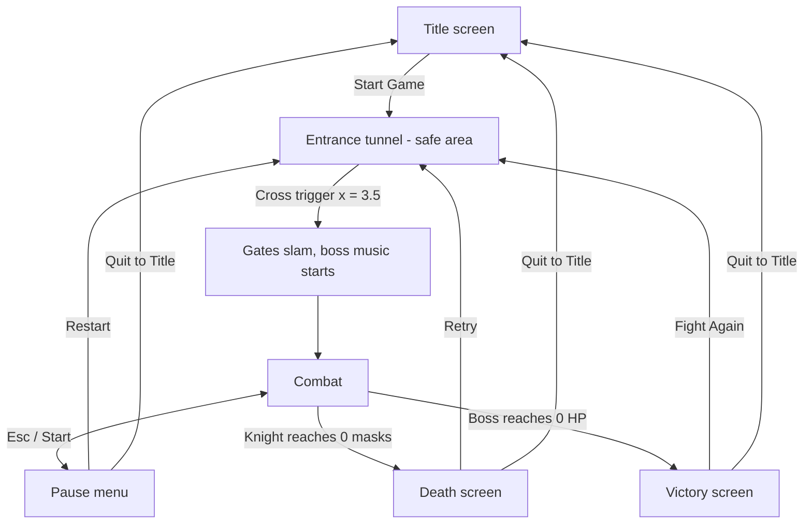

# Phase 2 Checkpoint: Systems Vertical Slice

**Project:** The Hallowed Summoner (working title in Phase 1: *The Hollow Warden*)  
**Course:** SWE402 - Game Development  
**Engine:** Unity 6000.5.11f1, URP 2D Renderer, Input System, Cinemachine 3  
**Date:** 20 November 2026  
**Repository:** https://github.com/WackAjmi/SWE402-Game-Project (Phase 2 tag: `v0.2-phase2`)

| Member | Phase 2 contribution |
| --- | --- |
| Mohammed Alajmi | All Phase 2 implementation: player, arena, audio, placeholder boss |
| Ayman Al Johani | Phase 2 implementation: game flow, UI, documentation|

---

## 1. Playable slice summary

The slice is playable from launch to a win or a loss, and both outcomes can be repeated without restarting the game.

| Boundary | Implemented behaviour |
| --- | --- |
| Start | Title screen (`Title.unity`) -> **Start Game** fades into `Arena.unity`. The Knight spawns in a 32-unit entrance tunnel with no threats. |
| Start trigger | Walking past x = 3.5 inside the arena raises `GameEvents.EncounterStarted`: both gates slam down with sound and camera shake, area music crossfades to boss music, and the boss wakes 1.5 s later. |
| Win | Boss health reaches 0 -> `GameEvents.BossDied`: attacks stop, the gates rise, the victory sting plays, and after 3.5 s a **Victory** screen shows fight time and attempt count with **Fight Again** / **Quit to Title**. |
| Fail | Knight reaches 0 masks -> death animation and slow motion, music fades, then a **Defeated** screen offers **Retry** / **Quit to Title**. |
| Retry | Reloads the arena scene, so every piece of encounter state (health, soul, boss, gates, music, timers) is rebuilt from scratch. Attempt count is kept in `GameSession`. |
| Exclusivity | The death and victory screens check each other's `IsShowing` flag, so only the first outcome is shown. |

**Core loop status:** read the boss's yellow telegraph -> jump, dash or move out of the slam -> strike or pogo during recovery -> build soul -> spend soul on an instant Focus heal. This loop works and repeats consistently against the placeholder boss.

**Known limitations (honest scope):**
- The boss is a **placeholder** (`DummyBoss`): 10 HP, contact damage and one telegraphed floor slam. The real boss, with a state machine, three attacks and two phases, is carried over to Phase 3 (section 6).
- No boss intro sequence and no boss health bar on the HUD yet; the dummy shows a small world-space bar.
- The menu text uses Unity's built-in font as a placeholder.

**Evidence** (in `docs/phase2/media/`):

| Title screen | Entrance tunnel | Gates closed, combat |
| --- | --- | --- |
|  |  |  |

| Pause menu | Defeat | Victory |
| --- | --- | --- |
|  |  |  |

Gameplay recording, from title to victory and to defeat: **[[Gameplay Footage](https://kfupmedusa-my.sharepoint.com/:v:/g/personal/s202065020_kfupm_edu_sa/IQAmMJRJTsFcQItnG0dFeJBYAa40Bp2hwhJTOi9LOwF8Ll4?nav=eyJyZWZlcnJhbEluZm8iOnsicmVmZXJyYWxBcHAiOiJPbmVEcml2ZUZvckJ1c2luZXNzIiwicmVmZXJyYWxBcHBQbGF0Zm9ybSI6IldlYiIsInJlZmVycmFsTW9kZSI6InZpZXciLCJyZWZlcnJhbFZpZXciOiJNeUZpbGVzTGlua0NvcHkifX0&e=E4JhXU)]**

---

## 2. Systems implementation status

### 2.1 Controls and interaction (core gameplay systems)

| Action | Keyboard / mouse | Gamepad | Status |
| --- | --- | --- | --- |
| Move | A/D or arrow keys | Left stick | Done |
| Look up / down (aims the nail) | W/S or arrow keys | Left stick | Done |
| Jump / double jump | Space | South (A) | Done: variable height, coyote time, jump buffer, one air jump |
| Dash | Left Shift | Right trigger | Done: 20 u/s for 0.25 s, 0.6 s cooldown, 0.15 s invulnerability, gravity off |
| Nail (side, up, down) | Left mouse / Enter | West (X) | Done: down-slash pogo and side-hit recoil |
| Focus heal | F | - | Done: instant, costs 33 soul, +1 mask, works on the ground or in the air |
| Pause | Esc | Start | Done |

Player rules: 5 masks; 1.3 s invulnerability after a hit; knockback 8 u/s sideways and 6 u/s up; 11 soul per nail hit (maximum 99).

Code: `PlayerController`, `PlayerHealth`, `PlayerSoul`, `SpriteFlasher` (`Assets/_Project/PlayerSide/Player/Scripts`).

### 2.2 Physics and collision

- **Layers and matrix:** `Ground`, `Player`, `PlayerHurtbox`, `PlayerHitbox`, `Boss`, `BossHurtbox`, `BossHitbox`. Only four pairs collide: Ground-Player, Ground-Boss, PlayerHitbox-BossHurtbox and BossHitbox-PlayerHurtbox. `Default` collides with nothing.
- **Hitbox / hurtbox model** (`Core/Scripts/Hitbox.cs`, `Hurtbox.cs`):
  - A `Hitbox` damages each `Hurtbox` at most once per activation, using a per-activation `HashSet`.
  - Team checks stop friendly fire.
  - Invulnerable targets are skipped.
  - Movement collision and damage collision are fully separate.
- **Pogo:** down-slashes bounce off any `Hurtbox` marked `Pogoable`. That includes the boss and the closed arena gates. The gates are "pogo-only" surfaces: they give no soul, they play a tink sound, and they push the Knight back.
- **Arena:** the solid floor, ceilings and walls are box colliders. The gates use a 1 x 6 blocker that is enabled only while a gate is closed, so the Knight cannot leave mid-fight.
- **Encounter trigger:** a position check against the Knight (x > 3.5 within a height band). It fires exactly once and needs no physics layer.

### 2.3 AI, combat and challenge logic

- **Placeholder boss** (`BossSide/Testing/DummyBoss.cs`):
  - It runs a timed loop: idle (2-3.2 s, randomised), telegraph (0.6 s fade to yellow), slam (9-unit floor hitbox for 0.15 s, camera shake), then back to idle.
  - A contact hitbox re-arms every 0.5 s, so standing inside the boss keeps hurting.
  - It is invulnerable until the encounter starts and is defeated after 10 nail hits.
- **Phase 3 plan:** this loop becomes an explicit finite state machine for the real boss: `Intro -> Idle -> SelectAttack -> Telegraph -> Active -> Recovery`, plus `PhaseTransition` and `Dead`.
  - It will have three attacks and a phase change at 50% health.
  - Distance filters which attacks are valid, the choice among them is weighted, and the same attack cannot be chosen more than twice in a row.
  - The design is unchanged from the Phase 1 proposal (section 4.3).
- **Placeholder boundary:** the dummy only talks to the rest of the game through `GameEvents` (`EncounterStarted`, `BossHealthChanged`, `BossDied`). Replacing it with the real boss requires no changes to gates, music or menus.

### 2.4 Game-state flow

- **Scenes:** `Title.unity` -> `Arena.unity`, in that build order.
- **Event bus:** `Core/Scripts/GameEvents.cs` is a set of static C# events. It connects the player side (`Game.PlayerSide` assembly) and the boss side (`Game.BossSide` assembly), which never reference each other directly.
- **Pause** (`PauseMenu`):
  - Sets `Time.timeScale = 0` and tells the hit-stop service to stop controlling time.
  - Pauses sound effects with `AudioListener.pause`; music keeps playing at half volume.
  - Disables the `Player` input action map.
  - Raises `GameStateChanged(Paused)`.
- **Unpause and scene change:** `SceneFlow.ResetRuntimeState()` restores time, audio and input before any scene load. This guarantees a retry never starts paused or with controls off.

---

## 3. UI and audio first pass

### 3.1 UI and feedback

| Element | Implementation |
| --- | --- |
| HUD | Soul vessel and masks from Hollow Knight's HUD sprites. The soul fill rises with a wavy edge, masks pop when lost or refilled, and the orb's face shows when full. Built at runtime from `HudArt`; driven only by `GameEvents`. |
| Menus | Title, pause, settings, death and victory screens are built at runtime by `MenuKit`. They work with keyboard, gamepad and mouse; the HK animated pointers mark the selected row. |
| Settings | Music and Sound sliders, saved in `PlayerPrefs` (`Core/Scripts/GameSettings.cs`). |
| Combat feedback | Hurt colour flashing during invulnerability; green flash on Focus heal; hit sparks (pooled); dash afterimages (pooled). Hit-stop: 0.08 s when hurt, 0.03 s on nail hits. Camera shake on hits, gate slams and boss slams; slow motion on death. The boss telegraphs in yellow and flashes white when hit. |
| Camera | Cinemachine follow camera with a confiner polygon. It follows through both tunnels and the 18-unit-tall room, and never shows past the rock. |

### 3.2 Audio

| Layer | Implementation |
| --- | --- |
| Music | `ArenaMusic` has three looping channels: Deepnest area theme, Deepnest ambience and boss music. All fades use unscaled time, so hit-stop does not stretch them. |
| Music events | Gate slam -> area theme fades out, boss music starts after 0.6 s. Boss death -> victory sting, then the area theme returns. Knight death -> music fades. Pause -> half volume. |
| Title | Main menu theme with a fade-in and fade-out. |
| SFX | Knight: jump, double jump, dash, five nail swing variants, hurt, death, heal, soft/hard landing, footsteps. Gate slam and open. Nail tink on gates. Menu clicks. |
| Mixing | The Sound slider drives `AudioListener.volume`. Music sources set `ignoreListenerVolume` and scale by the Music slider, so the two sliders are independent without an AudioMixer asset. All sounds are 2D, which matches the fixed side view. |

---

## 4. Playtest report

### 4.1 Setup

- **Tester:** Mohammed Alajmi (developer). No external testers yet; external playtests are a Phase 3 task (T13).
- **Build:** Unity Editor Play mode, from `Title.unity` and from the sandbox scene `Sandbox_A_Player.unity`.
- **Method:** after each feature, a scripted pass (move, jump, dash, every attack direction, heal, take damage, die, retry) and free play. Every issue was logged with steps to reproduce, then fixed and re-tested.

### 4.2 Findings and fixes

| # | Finding | Severity | Cause | Fix / status |
| --- | --- | --- | --- | --- |
| 1 | Every keyboard key threw "Map index out of range" during play | Blocker | The input actions asset was edited on disk while the Editor was open, which left the Input System's cached state stale | Fixed by restarting the Editor. **Process rule:** input and project-settings files are only edited inside Unity. |
| 2 | Focus heal only worked when F was held, and not in the air | High | Heal was implemented as a 1 s channel | Fixed: instant heal on press, allowed in the air (deliberate change from HK) |
| 3 | The death sound was cut off by the respawn | Medium | Respawn delay was shorter than the sound | Fixed: delay tuned to 5 s (sandbox only); the arena uses the death screen |
| 4 | Arena art was almost invisible | High | The scene's global 2D light only lit the `Default` sorting layer | Fixed: the light targets all sorting layers; intensity raised to 0.8 |
| 5 | The camera stayed in the room and would not follow into the tunnels | High | The confiner shape in the tunnels was exactly the camera's height (15 units), so the confiner shrank those parts away | Fixed: tunnel bounds enlarged to 17 units |
| 6 | Floor edges showed stray fragments of other objects | Low | The sprite sheet piece contained extra objects | Fixed: fragments removed, size kept so placement did not change |
| 7 | Eggs, cocoons and corpses cluttered the floor and hid the Knight's feet | Low | Readability | Fixed: props removed |
| 8 | Hitting the gates felt like hitting air | Medium | Gates had no damage surface | Fixed: gates are pogo-only surfaces with a tink sound, spark, 0.03 s freeze and recoil |
| 9 | HUD frame showed a stray line | Low | Crop of the atlas was too wide | Fixed: re-cropped |
| 10 | Frame drops seen in Play mode | Medium (investigated) | Only while the Profiler was recording in the Editor. PlayerLoop was within budget; the only per-frame allocation (368 B) came from the Editor-only `CinemachineBrain.OnGUI` | No gameplay fix needed; a development-build capture is scheduled for Phase 3 (T12) |
| 11 | Compile errors after adding the build tools (`Light2D` missing; `MenuItem` name clash) | Blocker | Missing reference to the URP 2D assembly; a game class shared a name with Unity's editor attribute | Fixed: reference added; attribute name fully qualified |

### 4.3 Open issues (prioritised)

| Priority | Issue | Planned fix | Task |
| --- | --- | --- | --- |
| P1 | Placeholder boss: one attack, no phases, no state machine | Implement the boss state machine with three attacks and two phases | T05, T06, T08 |
| P1 | No external playtests | At least three testers: attempts, clear time, confusing attacks | T13 |
| P2 | No Windows development-build profiler capture | 60 s combat capture in a development build; ten consecutive retries | T12 |
| P2 | No boss health bar on the HUD; no boss intro | Add both, driven by `BossHealthChanged` | T09 |
| P3 | Built-in placeholder font | Import a serif font and set it on `MenuArt` | T10 |
| P3 | Retry time not measured | Time from Retry to control; target is under 10 s | T12 |

---

## 5. Performance and debugging

- **Pooling:** hit sparks and dash afterimages use fixed pools, so gameplay creates no objects per hit.
- **Music import:** music clips stream from disk (Vorbis, quality 0.7).
- **Profiler session (Editor):**
  - The lag appeared only while recording.
  - The frame time was dominated by `EditorLoop`, not `PlayerLoop`.
  - The single recurring allocation (368 B/frame) came from `CinemachineBrain.OnGUI`, which runs only in the Editor.
- **Stability:**
  - Every global state change (time scale, audio pause, input map) is reset by one function, `SceneFlow.ResetRuntimeState`, before any scene load.
  - Static events are cleared on domain reload (`RuntimeInitializeOnLoadMethod`), so no subscriber survives between play sessions.

---

## 6. Production update

### 6.1 Workflow status

- **Commit history:** 16 descriptive commits on feature branch `a/player-knight`, merged into `main` through pull request **[#PR link]** and tagged `v0.2-phase2`.
- **Tracking:** until the checkpoint, work was tracked in commit messages only. At the checkpoint we created:
  - the Project board **The Hallowed Summoner - Production** (Backlog / Ready / In Progress / Review / Done): **[[board link](https://github.com/users/WackAjmi/projects/1)]**
  - one issue per Phase 1 task (T01-T14), with done tasks closed and linked to their commits

### 6.2 Task status against the Phase 1 plan

| ID | Task | Status |
| --- | --- | --- |
| T01 | Project, Git ignore, README, board, build target | Done |
| T02 | Greybox arena and entrance trigger | Done (Deepnest arena; gates seal the room once) |
| T03 | Movement, jump, double jump, dash | Done |
| T04 | Health, melee, shared damage rules | Done |
| T05 | Boss state machine and first attack | **Carry-over:** placeholder boss only |
| T06 | Second attack and phase transition | **Carry-over** |
| T07 | Focus heal, outcome flow, complete retry | Done |
| T08 | Third attack and attack selection | **Carry-over** |
| T09 | HUD, prompts, pause, volume controls | Mostly done; boss health bar and control prompts carried over |
| T10 | Sprites, animation, effects | Player done; boss carried over |
| T11 | Music, warning cues, credits | Music and credits done; boss warning sounds carried over |
| T12 | Profiling and restart stability | Started (Editor capture); development build carried over |
| T13 | External playtests | **Carry-over** |
| T14 | Final build and documentation | Phase 2 build and documentation done |

### 6.3 Changes from the Phase 1 proposal

| Proposal | Now | Reason |
| --- | --- | --- |
| Ruined cathedral arena | Deepnest arena with parallax layers and 2D lights | Matches the available art set |
| Fixed arena camera | Follow camera limited to the arena's shape | Allows the entrance tunnel and a taller room |
| No pogo or directional attacks | Up, side and down slashes with pogo | Down-slash pogo is core to the reference game's combat feel |
| Focus heal held for 1 s, Focus 0-9 | Instant heal, soul 0-99, 33 per heal | Design decision after playtesting (finding 2) |
| AudioMixer groups | Listener volume plus a music channel | Same result (independent sliders) with less setup; may move to a mixer in Phase 3 |

### 6.4 Phase 3 readiness

- [x] Start-to-end flow, win/fail and retry are stable. The real boss plugs in through `GameEvents` with no changes elsewhere.
- [x] Player kit, HUD, menus, settings, arena, camera and music are complete for this scope.
- [ ] Boss state machine, three attacks, two phases, warning sounds (T05, T06, T08)
- [ ] Boss health bar and intro (T09)
- [ ] Development-build profiling and a ten-retry stability run (T12)
- [ ] Three external playtests (T13)

---

## 7. How to run

See `README.md` for setup, controls and build steps, and `docs/credits.md` for asset credits (art and audio by Team Cherry, from *Hollow Knight*).
